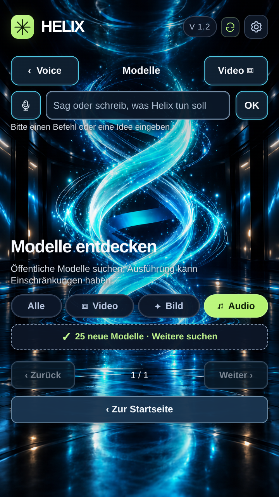

# HELIX · animierte Referenzoberfläche

Responsive Nachbildung der bereitgestellten Oberfläche. Die rekonstruierte Lichtspirale wird mit WebGL lokal verformt; ihre Bodenreflexion verwendet dieselbe Bewegungsphase mit gespiegelter vertikaler Verschiebung. Die Seitenarchitektur bleibt stehen. Ohne WebGL wird eine einfache CSS-Bewegung verwendet. Die Betriebssystemeinstellung für reduzierte Bewegung wird berücksichtigt; die Animation lässt sich zusätzlich unter Einstellungen umschalten.

## Vorschau als einzelne Datei

`standalone.html` herunterladen und im Browser öffnen. Die Grafik, Styles und Skripte sind darin eingebettet. Die komplette PWA wird über `index.html` bereitgestellt.

## Lokal öffnen

Im Projektverzeichnis `python3 -m http.server 8080` starten und `http://localhost:8080` öffnen. HTML, JavaScript, CSS und Bilder benötigen keinen Build-Schritt. Für Installation und Softwareupdates die Dateien gemeinsam über HTTPS bereitstellen.

## Softwareupdate veröffentlichen

Bei jedem Release `RELEASE` in `sw.js` erhöhen und die sichtbare Version in `index.html` sowie `app.js` angleichen. Alle Dateien gemeinsam veröffentlichen. Der Update-Button lädt den neuen Service Worker und die komplette zugehörige App herunter. Erst nach erfolgreichem Download aktiviert er die neue Version und lädt die App neu. `sw.js` sollte vom Hosting mit `Cache-Control: no-cache` ausgeliefert werden. Die Seite benötigt keine APK.

Die Modellübersicht bildet die Vorlage ab. Live-Modellsuche und Befehlsausführung benötigen noch einen angebundenen Modelldienst.

## Geprüft

- Chromium: 320, 360, 390, 720 und 1280 Pixel breite Ansichten ohne horizontalen Überlauf.
- Zeitversetzte Bildschirmaufnahmen bestätigen die Bewegung von Helix und Reflexion bei unveränderten seitlichen Säulen.
- Animationsschalter und reduzierte Bewegung geprüft.
- Softwareupdate mit zwei lokalen Test-Releases einschließlich Offline-Neustart geprüft.
- Eigenständige HTML-Vorschau ohne nachgeladene Grafik-, CSS- oder Skriptdateien geprüft.
